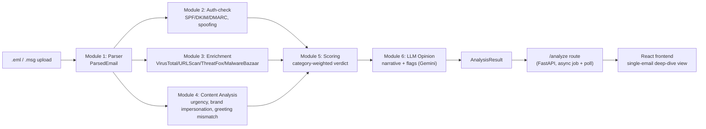
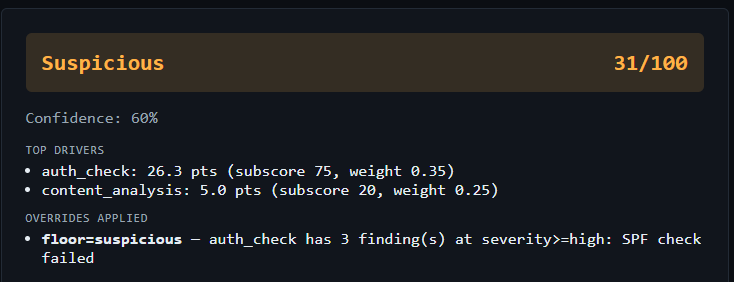
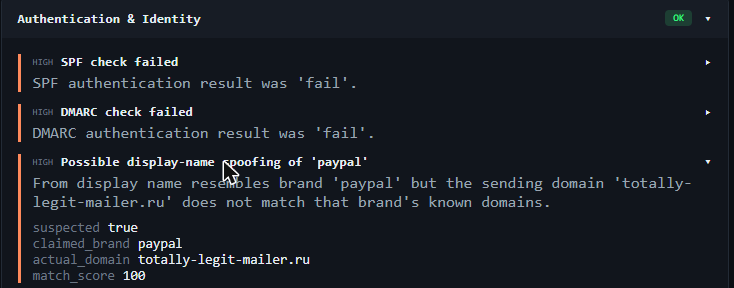
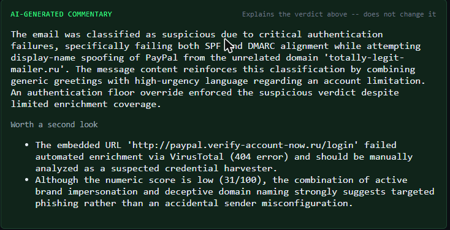

# Mail Analysis

A suspicious-email analysis and triage tool for SOC analysts. Upload a `.eml` or `.msg`
file and get back a scored verdict (Malicious / Suspicious / Inconclusive / No indicators found)
backed by a full evidence trail — every signal that contributed to the verdict is visible
and traceable, not folded into an opaque number. Built as a single-email deep-dive view for
Tier 1 analysts doing hands-on triage, not a batch-processing dashboard.

## Scope and limits in one place

* **It is an analyst-assist tool, not a filter.** The most common output is *Inconclusive*, usually with
  signals present; that means "a person should look", ordered by a priority score. **Never use any verdict to
  auto-close, auto-release, quarantine or delete mail.** *No indicators found* is not "safe": it means nothing fired
  **and** the sender is on your known-sender list with verified authentication.
* **It needs two local configurations to be useful** (both untracked, both empty by default): trusted receivers
  (`TRUSTED_RECEIVER_PATTERNS`) and a known-sender list (`known_senders.local.json`). Without them everything that is
  not flagged is inconclusive. Organisation-specific brands, aliases and gateway banners also live only in untracked
  local config.
  A third optional file, `own_domains.local.json` (copy `own_domains.local.example.json`), lists the organisation's own domains: a provider
  flag on one of them is shown as a conflict, never as confirmed malicious.
* **What is measured, honestly:** one real phishing sample (a hosting-provider lure, Kvish 6), a seeded split of a
  public phishing corpus (recall only, a poor proxy for this class), and 26 hand-written benign fixtures
  (regression guards, not an accuracy claim). **Real-world precision is not established.** See "Evaluation scope".
* **Known to be unproven or undetectable:** real-world false-positive rate; Hebrew and Israeli-brand phishing beyond the
  one sample; text-only business-email-compromise; image-only mail; attachment content (files are hashed and
  classified, never opened).

## Architecture

The pipeline runs six independent analysis stages in sequence, each consuming and producing
a shared, typed data contract:



**The shared contract is the key design choice.** Module 1 (`backend/app/parser/`) parses
raw `.eml`/`.msg` bytes into one `ParsedEmail` object — headers, addresses, body text/HTML,
extracted URLs, attachment hashes — regardless of source format. Every downstream module
(`auth_check`, `enrichment`, `content_analysis`) reads *only* that `ParsedEmail` and
produces a `ModuleResult`: a status plus a list of `Finding`s, each with a uniform shape
(`module`, `severity`, `title`, `description`, `evidence`, `weight`). Module 5
(`backend/app/scoring/`) reads a list of `ModuleResult`s — it doesn't know or care how they
were produced — and assembles the final `AnalysisResult`. Module 6 reads that
`AnalysisResult` and adds an `LLMOpinion`.

This meant each module could be built, tested, and reasoned about in isolation: enrichment
was developed and unit-tested with dependency-injected stub provider clients, content
heuristics with hand-built `ParsedEmail` fixtures, scoring with hand-built `ModuleResult`
lists — none of them needed a working end-to-end pipeline to be verified correct.

**`/analyze` is submit → poll → result, not a blocking request.** This was a deliberate
architectural decision, not an implementation shortcut. `POST /analyze` validates the
upload, kicks off the pipeline on a background thread, and returns `202` with a `job_id`
immediately; `GET /analyze/{job_id}` polls for status (`pending` → `running` → `done`/
`error`), including which module is currently executing. The reason: Module 3's enrichment
step throttles VirusTotal lookups to 4 requests/minute (its free-tier limit), and with the
default cap of 10 URLs + 10 attachment hashes per email, a link-heavy phishing sample can
legitimately take several minutes to fully enrich. A synchronous request would either time
out at the browser/proxy layer or force an analyst to stare at a blocked tab — polling with
live per-step progress was the correct shape for that latency profile, not an afterthought
bolted on later.

## Design rationale

### Scoring: category-weighted aggregation, not a flat point sum

`backend/app/scoring/` combines Findings from three signal categories using explicit,
inspectable weights (`ScoringConfig` in `scoring/config.py`):

| Category | Weight | Why |
|---|---|---|
| `enrichment` | 0.40 | External threat-intel hits (VirusTotal, ThreatFox, etc.) are the most objective signal available |
| `auth_check` | 0.35 | Protocol-level SPF/DKIM/DMARC and identity checks are reliable, low-noise |
| `content_analysis` | 0.25 | Fixed-phrase/heuristic signals are the softest, most tunable-later signal |

A flat point-sum treats every finding as equally trustworthy, which doesn't match how an
analyst actually reasons about evidence: a single confirmed-malicious VirusTotal hit is
worth more than a pile of soft content heuristics (urgency language, a generic greeting)
that could just as easily describe an aggressive-but-legitimate marketing email. So on top
of the weighted score, `scoring/overrides.py` applies explicit **floor and ceiling rules**:

- **Floor**: a single `severity="critical"` enrichment finding, or a single
  `severity="high"` auth_check finding (a confirmed SPF/DKIM/DMARC failure reported by a
  *trusted* receiver), forces the verdict to at least *Suspicious* — regardless of what the
  weighted score alone would produce. One hard indicator outranks a pile of soft ones. A
  display-name brand claim is **not** a hard indicator on its own (a dental clinic can be
  named like a brand): it is a MEDIUM finding.
- **Structural corroboration floor**: structural signals fall into three families —
  *sender* (hosting-style identity, local-submission first hop, brand name on a free
  mailbox), *link* and *claim* (see `docs/DETECTION_DESIGN.md`). Signals from **two different
  families** force *Suspicious*; any number of signals in one family count once, because they
  usually share a cause. The rule was fixed before the signals were tuned.
- **Content-only floor**: content_analysis's weight (0.25) means it can never mathematically
  cross the *Suspicious* score threshold (35) through weighted scoring alone — so 2+
  independently-firing high-severity content findings (e.g. urgency language *and* brand
  impersonation both firing) get their own floor to *Suspicious*, so a strong content-only
  signal still surfaces.
- **Ceiling**: content_analysis alone — with `auth_check` and `enrichment` both quiet — can
  never push the verdict to *Malicious*. Heuristic-only evidence isn't allowed to be the
  sole basis for the most severe verdict.
- **Inconclusive** (formerly `needs_review`): a confidence score (separate from the risk score) tracks how much
  reliable data actually went into the analysis — was an `Authentication-Results` header
  even present, did enrichment providers respond or come back rate-limited. When confidence
  is low and the score is non-trivial, the verdict becomes *Inconclusive* rather than
  guessing — this distinguishes "checked and clean" from "couldn't check," which a raw score
  can't express on its own.

### The inconclusive and "no indicators found" states: not a safety verdict

The verdict model is deliberately lopsided: **flagging needs evidence, and so does being cleared.**

- *Suspicious / Malicious*: findings, or findings corroborated across families, crossed a threshold.
- *Needs review* (shown as **inconclusive**; the literal rename lands last): nothing flagged, but "no findings" is not
  evidence of safety. Each one carries a sub-reason — `signals_present` (something fired but was not enough) or
  `no_signals_insufficient_evidence` (nothing fired and nothing positive was established) — and a numeric
  `priority` (a-priori formula in `docs/DETECTION_DESIGN.md`) so a queue can be ordered. The priority orders; it is not
  a probability.
- *Benign* (to be shown as **no indicators found**) requires **all** of: a verified, aligned DKIM pass or a DMARC pass
  from a **trusted receiver**; the sender's registrable domain on a **known-sender list**; no finding above info
  severity; and adequate coverage, including complete enrichment (an unknown or uninformative indicator counts as
  inadequate). Authentication alone is not enough: it proves who sent a message, not that the sender is legitimate, and
  attackers authenticate their own domains (11 of 75 tuning phish reached benign under the earlier
  authentication-only rule).

**"No indicators found" is not "safe".** It means this tool saw nothing and positively recognised the sender. **Do not
use it to auto-close, auto-release or auto-delete anything.** A human decides.

**Two configurations make the tool useful; without them it is not:**

| Setting | Where | Effect when missing |
|---|---|---|
| Trusted receivers (`TRUSTED_RECEIVER_PATTERNS`) | untracked `backend/.env` | SPF/DKIM/DMARC are `not_evaluated`; nothing can be benign |
| Known senders | untracked `backend/known_senders.local.json` (or `KNOWN_SENDERS_FILE`), `{"domains": ["example.com", ...]}` | no sender is ever recognised; nothing can be benign |

**An unconfigured deployment (no trusted receivers, no known-sender list) yields *inconclusive* for everything that is
not flagged, and that is not useful as a filter.** It still flags what it can see, but every other message lands in the
queue, ordered by priority. Configure both before relying on the benign state, and keep the known-sender list short
and deliberate: a domain on it is a domain whose mail can be cleared.

### Authentication trust: who may vouch for SPF/DKIM/DMARC

`Authentication-Results` and `Received-SPF` are just headers: any hop, **including the sender's
own server**, can write one that says `pass`. So a result only counts when a *trusted receiver*
demonstrably added it. Trusted receivers are a list of hostname regexes in
`TRUSTED_RECEIVER_PATTERNS` (JSON array in the untracked `backend/.env`; see `.env.example`),
and a result is trusted only if the host named in the header both matches a pattern **and** is the
`by` host of a hop in the message's `Received` chain.

- **Default: nothing is trusted.** Every method is reported `not_evaluated`, with the reason shown
  as a finding. Claims found in the headers are still listed, never hidden.
- **A pass is worth nothing.** A trusted SPF/DKIM/DMARC pass authenticates the sending
  infrastructure and domain; it never lowers a score. An attacker authorises their own servers for
  their own domain, so a pass is the expected result for phishing sent from attacker-controlled
  infrastructure. Alignment findings say exactly what was and was not proven.
- **An untrusted fail is a weak signal** (low weight): attackers gain nothing by forging a
  failure, but forwarded or stale upstream results can fail legitimately. An untrusted pass is zero.
- **Header position is an extra signal, not a gate.** A header added by a hop normally sits above
  that hop's `Received` line. When it sits below, an info finding says so. Exchange and some
  gateways reorder headers (the Kvish 6 sample's gateway SPF header sits below every `Received`
  line although the gateway really added it), and a sender can forge a whole header block, so
  position can neither prove nor disprove anything on its own.

**This trust model assumes your perimeter gateway strips inbound `Authentication-Results` and
`Received-SPF` headers before adding its own.** If it does not, a sender can forge both a header and
a matching `Received` line below your first trusted hop and the check cannot tell. Headers with no
authserv-id (a Microsoft quirk) can only be trusted by explicitly configuring a pattern that matches
the placeholder `unknown-authserv`; the evidence then states that attribution was not possible.

### Enrichment privacy: what leaves the machine

Threat-intel lookups send **hostnames, not URLs**. The path and query of a link — where per-recipient
tracking tokens live — are never sent unless a provider is named in `ENRICHMENT_PATH_QUERY_PROVIDERS`
(opt-in, default none). Internal-looking hosts (no public name, `.corp`/`.local`/`.internal`/`.lan`/`.test`,
single-label names, obfuscated address spellings like `127.1`, and private, loopback, link-local, multicast,
reserved, carrier-grade-NAT, documentation or IPv6-embedded-private addresses) are never sent to any provider; they
are UNKNOWN (not looked up), never clean, get no lookup links in the indicator list, and block a "no indicators
found" verdict. Attachments are looked up by **hash only**: no file and no file
name is ever uploaded. Every provider sits behind a guard (`app/enrichment/policy.py`) that exposes only
`lookup()` and raises rather than send a request outside the policy; VirusTotal and URLScan are queried
with GET only, and URLScan by search, so no scan is ever submitted. Each provider can be switched off with
`ENRICHMENT_DISABLED_PROVIDERS`.

**Unknown is never clean.** A provider that is disabled, not applicable, rate-limited, timed out, failed
or returned garbage makes that indicator *unknown*: a visible finding, lower enrichment coverage, and an
aggregated warning — never a quiet zero. Links on **shared platforms** (mass-mailers, link wrappers,
shorteners, SharePoint/OneDrive, Google Docs/Forms, Dropbox, site builders…) are reported as
*uninformative* and not looked up at all: their domains are reputable but host content anyone can
create, so "no detections" would mean nothing. The platform list is a config file
(`backend/app/enrichment/shared_platforms.json`, generic platforms only; organisation-specific additions
go in an untracked file named by `SHARED_PLATFORMS_EXTRA_FILE`). When an email has more lookups than the
per-email cap, the riskiest hosts are looked up first and every dropped indicator is listed with its rank
and reasons.

One deliberate consequence: URLScan's hit count measures how often a page was *scanned*, not whether it is
bad, so at host level it is shown as context and adds no risk.

### LLM opinion: commentary, never a second verdict

Module 6 (`backend/app/llm/`) is **off by default** (`LLM_ENABLED`): while off, nothing is sent to any
external model. When enabled it sends Gemini only the verdict, score, category numbers and the **titles**
of the findings — never their descriptions or evidence — with every address, hostname, URL, file name, IP
and internal-looking name replaced by a placeholder (`<HOST_1>`, `<URL_2>`, …). The model's reply is mapped
back to the real values locally, so the analyst reads real names while the model never sees them. It asks
for two things only: a plain-language narrative explaining *why* the verdict landed where it did,
and a list of things worth a second human look. The prompt explicitly forbids stating or
implying a different verdict than the one already computed by Module 5.

This is deliberate scope discipline, not a missed opportunity to let the LLM "do more." A
tool that shows an analyst two verdicts from two sources — a rule-based one and an
LLM-generated one — that can silently disagree is worse than one authoritative verdict with
supporting commentary: it forces the analyst to arbitrate between two systems instead of
trusting either. The rule-based scoring engine is auditable, deterministic, and already
carries its own full evidence trail; the LLM's job is to make that reasoning readable, not
to compete with it. If the LLM's narrative reveals something the rules missed, it surfaces
as a flagged note for human review, not an overriding verdict.

## Evaluation scope: what is and is not established

Read this before trusting any number from this project. Status as of 2026-10-03.

**Tuning-split results** (75 public phishing samples, offline stub enrichment; every rate with its Wilson 95% interval;
the hold-out is reported separately in `backend/tests/HOLDOUT_LOG.md` and was evaluated once):

| Mode | flagged | inconclusive | confidently "no indicators found" |
|---|---|---|---|
| STRICT (nothing trusted) | 6/75 = 8.0% [3.7-16.4%] | 69/75 = 92.0% [83.6-96.3%] | 0/75 = 0.0% [0.0-4.9%] |
| CONFIGURED (corpus gateway headers trusted) | 22/75 = 29.3% [20.2-40.4%] | 53/75 = 70.7% [59.6-79.8%] | 0/75 = 0.0% [0.0-4.9%] |

Most CONFIGURED flags come from trusted-gateway authentication failures, a feature of how the corpus was collected, not
from the structural families. These numbers say little about mail that reaches an inbox.

**What the evidence is**

- **Benign evidence is synthetic only.** The benign fixtures (`backend/tests/fixtures/benign/synthetic/`)
  are hand-written mails modelled on legitimate-but-scary patterns (ESP click-tracking, Safe Links
  wrappers, SPF-only senders, shared-hosting contact forms, near-miss display names). They are
  regression guards against over-flagging, **not** a sample of real mail. The slot for real benign
  mail (`benign/_from_user/`) is empty and the eval reports it as `0/0`.
- **Malicious evidence is one real sample, synthetic cases, and a public corpus.** One real, sanitized
  phishing email (the Kvish 6 invoice lure), five hand-written display-name-spoof positives, and a seeded
  50/50 tuning/hold-out split of the public `phishing_pot` corpus made by `scripts/select_corpus.py` on
  2026-10-02 (seed `20261003`, 8,611 usable samples, 75 tuning / 75 hold-out; raw samples stay local and
  gitignored, only the seed and SHA256 hashes are tracked in `CORPUS_MANIFEST.md`). Public phishing corpora
  contain **no benign mail**, so they can measure recall only.
- **Hold-out discipline.** Detections are tuned against the tuning split only. The hold-out split is
  evaluated once, via `python -m tests.eval --final-holdout`, which logs to `backend/tests/HOLDOUT_LOG.md`
  and prints aggregates only.

**What is NOT established**

- **Real-world precision (the false-positive rate on real mail) is unproven.** No pooled
  precision/recall is reported anywhere, because combining all-malicious corpora with small synthetic
  benign sets produces a number that means nothing.
- Recall on real phishing beyond the single sample is unknown until the held-out public samples are
  evaluated, and even then it is recall on *public, reported* samples (older, skewed toward what
  gets reported), not on what reaches an inbox.
- The offline eval assumes threat-intel providers report "no detections" for every URL, so it measures
  the structural signals alone, not enrichment.
- Results depend on configuration: with no trusted receivers configured, SPF/DKIM/DMARC are
  `not_evaluated`.

**How real-world false positives will be measured**: the local analyst feedback log (next section) records
agree/disagree per analysis, keyed by file hash, with verdict and signal names only.

### How to read the numbers (read before quoting any of them)

- **"0 missed" is true by construction, not a miss rate.** "Missed" means a confident *no indicators found* on a phishing
  sample. That verdict needs a sender on the known-sender list, and the list is empty in every phishing set the eval runs
  (the eval's CONFIGURED mode lists only the reserved example domains of the synthetic benign fixtures). So 0 missed says the
  rule cannot clear an unknown sender, which is its purpose. It says nothing about how often a real phish from a
  *known* sender (a compromised partner account) would be cleared; that is not measured.
- **Recall here means flagged (Suspicious or Malicious) only. Inconclusive is not a catch.** An inconclusive message is
  in the review queue, ordered by priority, but nothing in it was identified as phishing; counting it as detected would
  turn "needs a human" into "caught". Of the hold-out in STRICT mode, 8.0% was flagged and 92.0% was inconclusive.
- **What the Kvish mutation analysis shows, in plain words.** The local-submission hop (the message was injected by a
  process on the hosting box, not by an authenticated mail client) is the load-bearing signal: with it in place almost any
  one link or claim signal is enough to flag, and who the sender *appears* to be does not matter. **A phish sent through an
  authenticated mailbox, with a clean display name, a direct link and its own images, is invisible to the current signal
  families.** The structural detection targets one narrow class (an authenticated lure from hosting-provider
  infrastructure with a swapped call to action) and nothing here should be read as coverage of commodity phishing.
  Details: `backend/tests/KVISH_MUTATIONS.md`.
- **Still unproven:** real-world precision (the false-positive rate on real mail; the benign evidence is 26 hand-written
  fixtures and one of them is a known false positive); Hebrew and Israeli-brand phishing beyond the single Kvish sample (the
  Hebrew phrase lists are unreviewed by a native speaker); text-only business-email-compromise, advance-fee and sextortion
  mail; image-only mail (no OCR); attachment content (files are hashed and classified, never opened); lures sent through
  authenticated or compromised mailboxes; the branded-ESP carve-out D5 against real ESP headers (validated only on
  hand-written fixtures); and mail from a compromised vendor or partner account (it is not exempted, but the behaviour is
  unmeasured).
- **The hold-out is spent** (2026-10-03, once, results published as run in `backend/tests/HOLDOUT_LOG.md`). Any later change
  to a detector, weight, rule or threshold makes later hold-out runs "tuned after viewing hold-out".

### Analyst feedback log

Every finished analysis shows an *Agree / Disagree* control (plus an optional note) in the UI, backed by
`POST /analyze/{job_id}/feedback`. Entries go to a local SQLite file, `backend/feedback.local.sqlite`
(gitignored; `FEEDBACK_DB` overrides). A row holds only: the SHA256 of the file as received, verdict,
score, confidence, **signal names**, agree/disagree, source format, whether trusted receivers were
configured, timestamps and the note. It never holds email content: no subject, addresses, URLs, body or
finding text. Signal names are finding titles with every variable part cut off (for example
`auth_check.possible_display_name_spoofing_of`), and a test greps the database file for content from the
analyzed mail. The note is the one free-text field (500 characters; the UI asks you not to paste content).

`python -m app.feedback summary` (run from `backend/`) reports reviewed/agree/disagree, **suspected false
positives among reviewed flagged verdicts**, suspected false negatives, and the signals present when a
flagged verdict was disagreed with; `python -m app.feedback export` writes CSV. Reviewed analyses are
self-selected by whoever reviews them, so this is a signal for finding noisy detections over time, not an
unbiased error rate.

### What the detectors can and cannot see

- **Content analysis covers English and Hebrew only.** The urgency phrases, generic-greeting rules and
  brand-in-body checks exist for those two languages. Mail in any other language is *identified* (by function
  words, not content lexicons) but not analysed: its content coverage is reduced to 0.25, so content analysis
  alone can never support a benign verdict, and an informational finding says so. Language-agnostic signals —
  links, sender infrastructure, headers and authentication — still apply to every language. On the public
  tuning sample, roughly 58% of mail with enough text was not English; no lexicons were added for other
  languages.
- **Not detectable with the current design:** text-only mail with no URL, no attachment and nothing
  structural (business-email-compromise, advance-fee and sextortion-style lures); image-only mail (there is no
  OCR, and an empty-text body gets content coverage 0.25 with a finding that says it is absence of evidence);
  and attachment *content* (files are hashed and classified by extension, never opened).
- **What the structural detection is aimed at, and what it is not.** The sender, link and claim signals
  (`docs/DETECTION_DESIGN.md`) target one class: an **authenticated lure sent from hosting-provider
  infrastructure with a swapped call to action** (a cloned template, a borrowed ESP tracker, assets hot-linked from
  the impersonated entity, a sender that is a server name). The public phishing corpus measures this class
  **poorly**: most of its samples are other things (credential forms, text-only lures, attachments, mail from
  compromised accounts), so a low recall on it says little about this class, and a high one says little about
  mail that reaches an inbox. The Kvish 6 sample is the only real instance of the class in the evidence.
- **"Inconclusive, signals present" is the expected output for most messages, and it is for analyst review, not a
  gateway filter.** A single family of weak signals is deliberately not enough to flag, and benign needs a known
  sender, so nearly everything lands in the review queue ordered by priority. Do not use any verdict to block,
  quarantine, release or delete mail automatically.
- **The branded-ESP carve-out in link signal L1 (decision D5) is validated only on hand-written fixtures and needs
  verification against real ESP headers.** The assumption (a branded return-path or DKIM `d=` on the sender's own
  domain, mail arriving over the network, means the platform's name is legitimately absent from the path) comes from
  vendors' documentation, not from real captured messages.
- **C2 (claimed-entity mismatch) is a weak, evadable signal.** Any `DKIM-Signature` header silences it, whether or
  not anyone verified it, and an attacker can add one for free. **Structural detection adds few flags on commodity
  phish**: on the public tuning sample most flags in CONFIGURED mode come from trusted-gateway authentication failures,
  not from the sender, link and claim families, which together added only a handful (see `docs/DETECTION_DESIGN.md`).
- **Known false-positive class (reported, not tuned):** a third party sending a newsletter for a brand from its
  own domain, linking and hot-linking the brand's site, looks like a cloned brand template from an unrelated origin
  (claim signal C3 plus link signal L2, two families). It is fixture `22_...` in the benign set and is marked as an
  expected failure in the tests. A known-sender exemption was considered and **rejected**: compromised vendor and partner
  accounts pass identity checks, so exempting them would repeat the mistake of treating authentication as legitimacy.
- **Brand aliases** (Hebrew names, transliterations, organisation names) are configured only in the untracked
  `backend/brands.local.json` (`{"brand": {"domains": [...], "aliases": [...]}}`); the tracked code carries generic
  brands only.
- **Authentication results only count from trusted receivers** (see "Authentication trust"). Out of the box
  nothing is trusted, so SPF/DKIM/DMARC are `not_evaluated`.
- **The eval reports two trust modes side by side.** *STRICT* trusts nothing (what a default deployment sees);
  *CONFIGURED* trusts the headers the corpus collector's gateway wrote. The public corpus carries that
  collector's SPF/DKIM/DMARC *failures* far more often than mail that reached a gateway-protected inbox would,
  so CONFIGURED shows what trusting a gateway adds, **not** real-world recall. The final hold-out run reports
  both modes (pre-registered in `backend/tests/HOLDOUT_LOG.md`).

## Testing & real-world validation

The backend test suite is network-isolated via dependency injection — every module that
touches an external service (`enrichment`'s provider clients, `llm`'s Gemini client) accepts
an injectable client so tests run against stub responses shaped like real provider payloads,
never live calls.

The pre-commit hook's wording check scans the working tree (the static scope) and is a fast first filter only; **the pytest gate (`test_wording_enforced.py`, which also covers what the app prints at run time) is the complete check.** Every finding also carries a stable, content-free code naming its kind (`backend/app/finding_codes.py`); a test fails if a finding is built without one.

**The centerpiece: real-world data surfaced a bug synthetic fixtures had been hiding.**
Every `.eml` test fixture in this project was hand-built with clean, RFC-compliant headers.
When a real (sanitized) `.msg` sample was finally added to close out a known fixture gap, it
immediately broke Module 2's auth-check parser: the sample's `Authentication-Results` header
was genuinely Microsoft/Office365-generated, and it violated RFC 8601 in two ways the
`authres` library's strict parser rejected outright — no `authserv-id` before the first
result token, and a trailing `;` after the last one. The parse failure meant SPF/DKIM/DMARC
results were silently discarded entirely, degrading to "no data available" — which, for this
specific sample, meant a real `dmarc=fail` was being hidden. The verdict flipped from a
correct **Suspicious** to a false-negative "legit" (the verdict's old name) purely because the header didn't match
the textbook shape every prior test fixture happened to use. Fixed with a normalize-and-retry
step (strip the trailing `;`, synthesize a placeholder authserv-id) plus a regex-based
fallback extraction so a method result can never be silently lost to an unanticipated
formatting quirk again.

The same `.msg` sample also caught a second, `.msg`-specific bug: `extract-msg`'s `htmlBody`
property is always `bytes`, never `str` (confirmed by reading its source) — an
`isinstance(x, str)` check in the original parser silently discarded the HTML body on every
single `.msg` file, falling back to plain text. Fixed by decoding via `BeautifulSoup`'s own
`UnicodeDammit` encoding-detection utility.

Neither bug was `.eml`-only or `.msg`-only in a clean way: the `authres` parsing bug would
have affected `.eml` too, it just never had a chance to — every `.eml` fixture in the repo
was synthetic and RFC-clean. It's a concrete example of why testing against real-world
samples matters even when synthetic fixtures already provide good structural coverage.

## Screenshots

From a live run against the `spoofed_display_name.eml` fixture (real SPF/DMARC failure,
display-name spoofing, and a real Gemini call — nothing here is mocked).

- **Summary/verdict card** — final verdict, score, confidence, and top scoring drivers
  
- **Expanded per-module evidence panel** — a module's Findings with evidence drilled down
  
- **LLM opinion card** — visually distinct from the rule-based verdict sections above it
  

## Tech stack & setup

**Backend**: Python, FastAPI, Pydantic v2. Key libraries: `authres` (SPF/DKIM/DMARC
parsing), `rapidfuzz` (fuzzy brand matching), `beautifulsoup4` (HTML parsing),
`extract-msg` (Outlook `.msg` parsing), `google-genai` (Gemini). Full list in
`backend/requirements.txt`.

**Frontend**: React 19, Vite, TypeScript. Vitest + React Testing Library for tests.

**Enrichment**: four first-party, read-only lookup providers in `backend/app/enrichment/providers/` —
VirusTotal, urlscan.io, ThreatFox and MalwareBazaar — plus the risk scorer that turns their answers into
the enrichment findings. The repository is self-contained: it has no dependency on any other repository
and no path or `sys.path` configuration. The provider code originated in the author's earlier IOC_Enricher
project and is now maintained here independently (see "Origin of the provider code").

| Provider | What it is asked | Key |
|---|---|---|
| VirusTotal | the report for a domain, IP, file hash or URL (GET only; nothing is uploaded) | `VT_API_KEY` |
| urlscan.io | a search of scans that already exist (never submits a scan) | `URLSCAN_API_KEY` |
| ThreatFox | an exact-match question about an indicator | `THREATFOX_API_KEY` |
| MalwareBazaar | a question about a file hash | `MALWAREBAZAAR_API_KEY` |

Put your keys in `backend/.env` (untracked). A source without a key reports "disabled", and its indicators are
UNKNOWN, never clean. The privacy rules in "Enrichment privacy" (hostname-only by default, per-provider
off-switch, risk-ordered capping) are enforced in `app/enrichment/policy.py`, in front of every provider.

### Setup

**Analysts on Windows: use `docs/QUICKSTART_WINDOWS.md`** (`setup.ps1` then `run.ps1`; a Docker setup also exists but is **written and untested**: it has never been built or run, so treat it as a draft). It serves the API and the web UI from one
process on `http://localhost:8000`. The block below is the developer setup (separate dev servers).

```bash
# Backend
cd backend
python -m venv .venv
.venv\Scripts\activate
pip install -r requirements.txt
copy .env.example .env        # add your provider API keys (all optional)
pytest                        # 61 tests should pass
uvicorn app.main:app --reload # serves on http://localhost:8000

# Frontend (separate terminal)
cd frontend
npm install
npm test                      # Vitest suite
npm run dev                   # serves on http://localhost:5173, proxies /analyze to :8000
```

`backend/.env` holds this project's own copies of provider API keys (`VT_API_KEY`,
`URLSCAN_API_KEY`, `THREATFOX_API_KEY`, `MALWAREBAZAAR_API_KEY`, `GOOGLE_API_KEY`). Any
provider without a key configured degrades gracefully to a "disabled" status per finding
rather than failing the analysis.

**Scope note**: this tool is designed to run on a personal/home network only. It is not
hardened for multi-tenant or production deployment — no auth on the API, an in-memory job
store that doesn't survive a restart, and no CORS/reverse-proxy story beyond the local Vite
dev-server proxy.

## Known limitations / next steps

- **Content analysis is deliberately rule-based, not ML-driven.** Module 4 uses fixed
  phrase lists and exact-match brand detection rather than a trained classifier or fuzzy
  NLP. This is a scoping choice, not a gap: it keeps every finding explainable (an analyst
  can see the exact phrase or brand match that fired) — a deliberate trade-off against the more
  general but less transparent detection an ML model could offer. Whether it also keeps the
  false-positive rate low is *not* established: see "Evaluation scope" above. Module 6 (the LLM layer) is where more open-ended
  pattern recognition lives, scoped narrowly as commentary rather than a verdict source.
- **The `.msg` test fixture validates pipeline correctness, not phishing-pattern coverage.**
  The real sample used to close out the `.msg` parsing gap (and that found the two bugs
  above) is a short, benign test email — genuinely useful for exercising encoding and
  header-format edge cases, but it doesn't exercise Module 4's content heuristics or Module
  3's enrichment against a real malicious `.msg` payload the way the hand-built `.eml`
  phishing fixtures do. A real (sanitized) phishing-shaped `.msg` sample is a natural next
  addition.
- **No production/multi-tenant hardening**, per the scope note above — this is a portfolio
  and personal-use tool, not a deployment-ready service.

## Origin of the provider code

The lookup providers (VirusTotal, urlscan.io, ThreatFox, MalwareBazaar), the risk scorer and the small
Gemini chat client began in an earlier project of the author, a standalone IOC lookup and batch-enrichment
tool. Only the pieces this app uses were copied, as first-party code under
`backend/app/enrichment/providers/` and `backend/app/llm/gemini_client.py`, and they are now maintained
here separately: changes there are not mirrored back, and nothing here imports from it. The copy was
verified against the original with identical fake HTTP (544 scenarios: same results, same requests) and
against 765 recorded scorer outputs before the dependency was removed.
